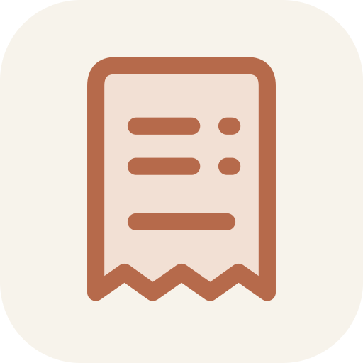

# SpendCodex

[English](README.md) · **Русский** · [Скачать APK](https://github.com/MAppleDm/SpendCodex/releases/latest)

Журнал расходов с вводом через DeepSeek. Из той же семьи, что и [FatCodex](https://github.com/MAppleDm/FatCodex).

Пиши, как было: **«вчера кофе 350, такси домой 820»**. Нажми на стрелку — DeepSeek выделит расходы,
выберет категории и добавит теги. После проверки записи сразу появятся в ленте. Лишнее можно отменить одним нажатием,
любую запись — открыть и исправить. Чата и аналитического дашборда нет.

## Начало работы

1. Выбери основную валюту. Она используется, когда в тексте не указана другая.
2. Нажми **Настроить DeepSeek** и сохрани свой API-ключ. На этом экране есть ссылка на получение ключа.
   Для ввода текстом нужны интернет и средства на API-аккаунте DeepSeek.
3. Вводи расходы обычным текстом. Отправка происходит только по нажатию на стрелку или Enter.

Например: `кофе 350`, `такси 820 вчера`, `продукты 32.90 EUR`, `обед 700 #работа`, `кофе 350, хлеб 60`.
Теги не обязательно указывать самому. DeepSeek добавляет подходящие и переиспользует уже знакомые названия.
Непонятную сумму, валюту или дату нужно уточнить; придуманную моделью сумму нельзя принять кнопкой подтверждения.
Если сеть недоступна, текст остаётся для повторной отправки.

**Ручной ввод** — значок листа с плюсом наверху, рядом с лупой. Он работает без сети и ключа.
В форме доступны сумма, валюта, категория, дата, время, получатель, теги, заметка и фото чеков.
Тап по записанному расходу открывает правку, повтор, возврат покупки и удаление с отменой.

## Только расходы

Сверху — траты за сегодня по каждой валюте. Это учёт расходов, а не баланса: способов оплаты, оплаты по умолчанию
и остатков на картах и наличных нет.
Доходы, переводы и корректировки новых остатков не добавляются. Возврат покупки оформляется из её карточки
и показывается отдельно от трат.

Старые доходы и переводы при обновлении сохраняются. Их можно найти через **Поиск → Тип → Ранее записанные операции**;
полная ручная копия включает их без изменений. В обычной ленте и поиске по умолчанию — расходы и возвраты.

Лупа открывает поиск: текст, даты, категория, теги и валюта в любом сочетании.
Найденное можно сразу выгрузить.

## Фото чеков

В карточке расхода: **Фото чеков → Камера / Из галереи**, до 10 снимков. Фото сжимаются на телефоне,
оригиналы в галерее сохраняются. Миниатюра открывает просмотр с увеличением. Изменения фото применяются вместе
с сохранением записи; удаление можно отменить. При повторении расхода прежний чек не копируется.

## Данные и точность

- Деньги хранятся целыми копейками, центами или иенами с точностью валюты. Лишние знаки отклоняются, а не округляются.
- Валюты не складываются и автоматически не конвертируются. Неизвестное время остаётся неизвестным.
- Одна отправка создаёт одну пачку записей. Повторные нажатия не создают дублей; вся пачка сохраняется вместе.
- Исходный текст сохраняется вместе с признаком `origin=ai`. Категории и теги можно исправить.

При отправке в DeepSeek уходят **твой текст с суммами**, текущая дата, часовой пояс, основная валюта,
категории с ключевыми словами и названия тегов. История и фото не отправляются.
Ключ хранится зашифрованным и используется для запросов к DeepSeek; в выгрузки он не включается.
Сохранённый журнал остаётся на телефоне; синхронизации между устройствами нет.

**Настройки → Данные**:

- **Резервная копия** — ручной ZIP со всем журналом, фото, JSON, CSV, описанием формата и контрольными суммами.
- **Восстановление** — проверка копии и замена журнала одной операцией; прежние данные сначала сохраняются
  в страховочную копию. Старые копии без фото поддерживаются.
- **Выгрузка для анализа** — пакет для внешнего ИИ, JSON или CSV; можно выбрать период и включение заметок.
  В анализ включаются метаданные фото; изображения входят только в полную копию.

Формат: [docs/export/format.md](docs/export/format.md). Есть RU/EN, блокировка по биометрии/PIN и обновления с GitHub, а в **Настройки → Тема** два оформления: чёрно-белое или авокадо 🥑 (по мотивам тем Avocado для KDE Plasma и Omarchy), оба следуют светлой/тёмной теме телефона.

## Сборка

Android 8.0+, Kotlin/Compose/Room. Для сборки нужны JDK 17+ и Android SDK 37.

```bash
cd android
./gradlew assembleRelease
```

Подробности и тесты: [docs/development.md](docs/development.md). Без собственного keystore APK подписывается
существующим debug-ключом. Проверки используют подставной сервер DeepSeek; настоящий ключ и реальный телефон
в автоматических проверках не используются.

MIT, см. [LICENSE](LICENSE).
